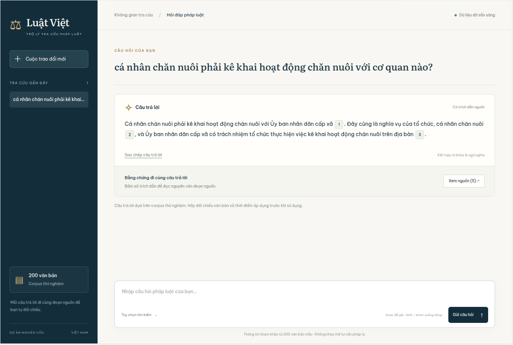
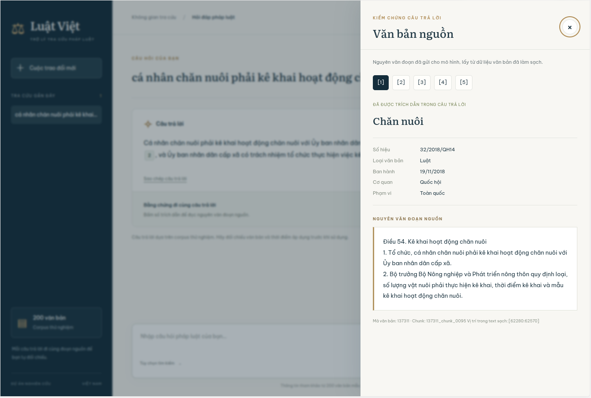
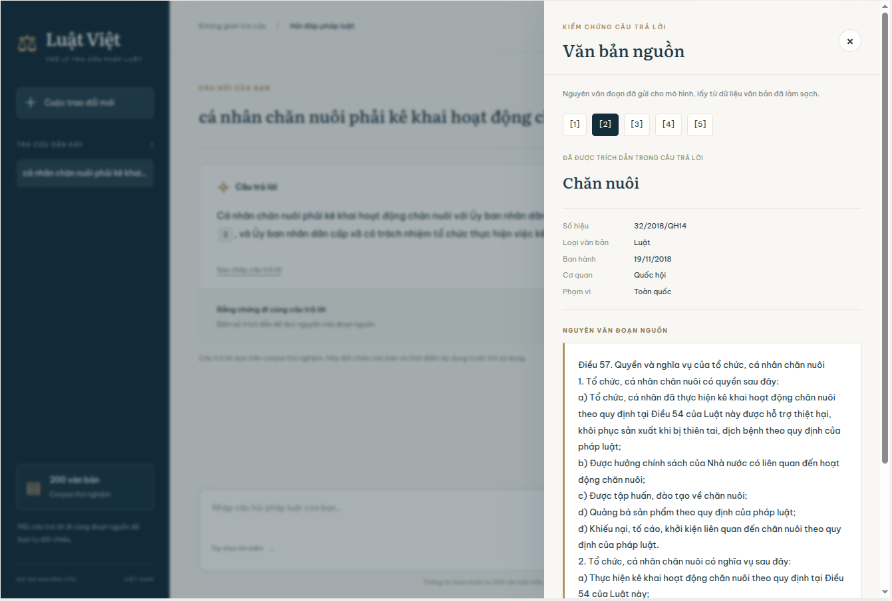
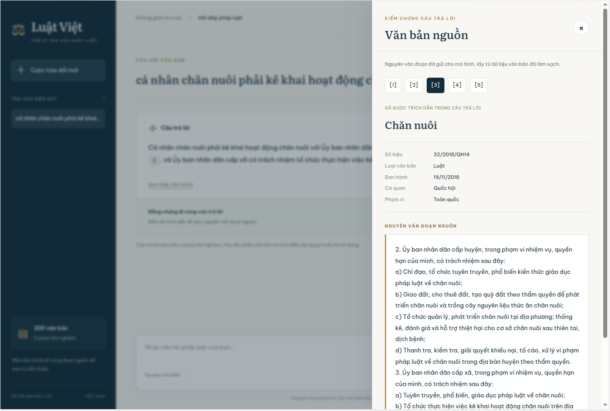

# ⚖ Luật Việt — Vietnamese Legal RAG

Ứng dụng hỏi đáp pháp luật tiếng Việt. Khi nhận câu hỏi, hệ thống tìm những đoạn văn bản liên quan, dùng LLM để soạn câu trả lời và kèm trích dẫn để người đọc đối chiếu.

Bản demo sử dụng **200 văn bản, 7.526 chunk và 30 câu hỏi đánh giá**. Dự án dùng BM25 và Chroma để tìm kiếm, Qwen3-Embedding-0.6B để tạo embedding, DeepSeek để trả lời, FastAPI và HTML/CSS/JavaScript để làm web.

## Giao diện

Ví dụ: “Cá nhân chăn nuôi phải kê khai hoạt động chăn nuôi với cơ quan nào?”

Hệ thống trả lời **Ủy ban nhân dân cấp xã**. Người dùng có thể bấm vào từng trích dẫn để đọc đoạn nguồn. Câu hỏi này không nằm trong bộ 30 câu đánh giá.

### Câu trả lời



### Nguồn [1] — Điều 54: kê khai hoạt động chăn nuôi



### Nguồn [2] — Điều 57: quyền và nghĩa vụ của người chăn nuôi



### Nguồn [3] — Trách nhiệm của UBND cấp xã



## Cách hoạt động

Dữ liệu được tải về, làm sạch HTML và chia thành các đoạn nhỏ (chunk). Từ các chunk này, chương trình tạo hai bộ dữ liệu tìm kiếm: BM25 để tìm theo từ khóa và Chroma để tìm theo ý nghĩa.

```text
Câu hỏi
   ↓
BM25 + tìm kiếm ngữ nghĩa
   ↓
Kết hợp thứ hạng bằng RRF, lấy 5 chunk
   ↓
Gửi câu hỏi và các chunk cho LLM
   ↓
Câu trả lời kèm trích dẫn
```

Web mặc định dùng cách kết hợp trên (hybrid). Người dùng cũng có thể chọn riêng BM25 hoặc dense trong phần tùy chọn tìm kiếm.

Trong bản demo, web và dữ liệu chạy ở local. Model embedding chạy trên Kaggle bằng vLLM; local gọi đến model qua ngrok. DeepSeek được gọi qua dịch vụ API. Nếu có máy GPU phù hợp, có thể chạy vLLM ngay trên máy đó thay cho Kaggle.

## 1. Cài đặt dự án

Cần có Git và Conda. Mở terminal:

```bash
git clone https://github.com/nhannhan2201/Vietnamese_Legal_Rag.git
cd Vietnamese_Legal_Rag
conda create -n legal-rag python=3.11 -y
conda activate legal-rag
python -m pip install -e .
```

Nếu đã tạo môi trường `legal-rag`, không cần tạo lại. Các lệnh tiếp theo được chạy từ thư mục gốc dự án. Web không cần cài Node hoặc npm.

## 2. Chạy model embedding bằng vLLM

### Chạy trên Kaggle

Import file [vllm-serving-embedding-model.ipynb](vllm-serving-embedding-model.ipynb) lên Kaggle.

1. Bật **Internet** và chọn **GPU T4**.
2. Vào **Add-ons → Secrets**, tạo và bật quyền truy cập cho:
   - `VLLM_API_KEY`: khóa bạn tự đặt để bảo vệ model đang serve.
   - `NGROK_AUTHTOKEN`: token lấy từ tài khoản ngrok.
3. Chạy lần lượt các cell trong notebook. Notebook sẽ cài môi trường riêng, lấy code repo và chạy `scripts/serve_embedding.sh`.
4. Đợi kiểm tra embedding thành công: có key trả HTTP 200 và vector 1.024 chiều.
5. Chạy cell mở ngrok, sao chép giá trị **`EMBEDDING_BASE_URL`** để dùng ở local.

Ví dụ URL nhận được:

```text
https://YOUR-DOMAIN.ngrok-free.dev/v1
```

Giữ phiên Kaggle chạy khi tạo index hoặc dùng web. Nếu Kaggle dừng phiên, server embedding cũng dừng; cần chạy lại notebook và cập nhật URL nếu nó thay đổi. Không chạy lại cell khởi động server khi server cũ vẫn đang chạy.

Notebook dùng `vllm==0.18.0` và `torch==2.10.0+cu129`. Lần đầu có thể mất thời gian để tải thư viện và model. Khi cần xem log, chạy trong một cell mới:

```python
print(LOG.read_text(errors="replace")[-8000:])
```

### Chạy trên máy local có GPU

Có thể bỏ qua phần này nếu đã dùng Kaggle. Tạo môi trường riêng cho vLLM để không ảnh hưởng môi trường `legal-rag`:

```bash
conda create -n legal-rag-serving python=3.13 -y
conda activate legal-rag-serving
python -m pip install wrapt
python -m pip install "vllm==0.18.0" "torch==2.10.0+cu129" --extra-index-url https://download.pytorch.org/whl/cu129
```

Trong thư mục repo, nhập khóa rồi chạy server:

```bash
read -rsp 'VLLM_API_KEY: ' VLLM_API_KEY
export VLLM_API_KEY
bash scripts/serve_embedding.sh
```

Giữ terminal này chạy và mở terminal khác để chạy dự án. Endpoint embedding lúc này là `http://127.0.0.1:8000/v1`, không cần ngrok.

Script dùng Qwen3-Embedding-0.6B, FP16, GPU 0 và giới hạn đầu vào 2.048 token. Phiên bản model được cố định trong script và `configs/project.yaml`. Script không tự đọc `.env`; khóa nhập ở trên phải giống khóa của client ở bước tiếp theo.

Cấu hình này đã được thử trên Kaggle Tesla T4. Nếu chạy trên máy khác, cần driver phù hợp với bản PyTorch/CUDA đã cài; xem [hướng dẫn vLLM](https://docs.vllm.ai/en/v0.18.0/getting_started/installation/gpu/) khi gặp lỗi môi trường.

## 3. Điền cấu hình trong `.env`

Quay lại môi trường dự án và tạo file cấu hình nếu chưa có:

```bash
conda activate legal-rag
cp -n .env.example .env
```

Mở `.env` và điền URL, khóa của bạn:

```dotenv
EMBEDDING_BASE_URL=https://YOUR-NGROK-DOMAIN/v1
VLLM_API_KEY=your-embedding-server-key

LLM_BASE_URL=https://api.vilao.ai/v1
LLM_MODEL=chib/deepseek-v4.1-flash
LLM_API_KEY=your-llm-provider-key
```

Nếu vLLM chạy cùng máy, dùng `EMBEDDING_BASE_URL=http://127.0.0.1:8000/v1`.

`VLLM_API_KEY` phải khớp khóa đã đặt trên server embedding. Không dùng `NGROK_AUTHTOKEN` vào đây. URL chỉ cần đến `/v1`; code tự thêm `/embeddings` hoặc `/chat/completions` khi gửi request.

Ví dụ trên dùng DeepSeek qua ViLao. Có thể thay URL, model và key của một dịch vụ chat API tương thích khác. Code đọc `.env` ở gốc dự án; không cần export lại từng biến trong terminal. Không đưa file `.env` thật lên GitHub.

## 4. Chuẩn bị dữ liệu

Nếu đã có dữ liệu và index từ lần chạy trước, có thể chuyển sang bước 5.

Nguồn dữ liệu là [vietnamese-legal-documents](https://huggingface.co/datasets/th1nhng0/vietnamese-legal-documents). Chương trình tải toàn bộ ba file nguồn về, sau đó chọn 200 văn bản để chạy thử:

```bash
python -m legal_rag.data.download
python -m legal_rag.data.sample
python -m legal_rag.data.clean
python -m legal_rag.data.chunk
```

- `download`: tải metadata, nội dung và quan hệ văn bản vào `data/raw/`.
- `sample`: ghép metadata với nội dung theo ID, chọn 200 văn bản và lưu vào `data/processed/sample_200/documents.jsonl`.
- `clean`: chuyển HTML thành text, lưu ở `cleaned_documents.jsonl`.
- `chunk`: chia text và lưu tất cả chunk trong `chunks.jsonl`.

Tập mẫu có 5 loại: Luật, Nghị định, Thông tư, Nghị quyết và Quyết định, mỗi loại 40 văn bản. Danh sách ID được lưu trong `configs/sample_200_ids.json` để các lần chạy dùng cùng tập mẫu.

Chương trình ưu tiên chia theo Điều. Phần dài được chia tiếp thành chunk tối đa 1.000 ký tự, với overlap mục tiêu 200 ký tự trong cùng phần. Văn bản không nhận diện được Điều được chia theo đoạn, dòng rồi khoảng trắng. Mỗi chunk giữ nội dung, metadata, ID văn bản và vị trí trong text sạch.

### Xây BM25 và Chroma

```bash
python -m legal_rag.retrieval.bm25
python -m legal_rag.retrieval.dense
```

Lệnh dense cần server embedding ở bước 2 đang hoạt động. Nó đọc các chunk, gửi text đến vLLM để tạo vector rồi lưu vào Chroma.

Kết quả được lưu tại:

```text
data/indexes/sample_200/
├── bm25.pkl
├── chroma/
└── manifest.json
```

Chroma được mở trực tiếp bằng thư viện Python, không cần chạy Docker hoặc một server Chroma riêng. Những file này được dùng lại khi tìm kiếm, không cần tạo lại mỗi lần mở web.

Dữ liệu và index được tạo ở local, không đính kèm trong repo GitHub.

## 5. Mở web

Sau khi đã có index, `.env` được điền và server embedding đang chạy:

```bash
conda activate legal-rag
python -m uvicorn legal_rag.app.api:app --host 127.0.0.1 --port 8001
```

Đợi dòng `Application startup complete`, sau đó mở **http://127.0.0.1:8001/**.

Giữ terminal chạy trong lúc sử dụng. FastAPI phục vụ cả giao diện và API nên không cần lệnh riêng để mở UI. Có thể xem tài liệu API tại **http://127.0.0.1:8001/docs**.

Thử nhập câu hỏi:

> Theo Luật Chăn nuôi năm 2018, cá nhân chăn nuôi phải kê khai hoạt động chăn nuôi với cơ quan nào?

Bấm số trích dẫn trong câu trả lời để đọc nguyên văn nguồn. Lịch sử câu hỏi chỉ lưu trong tab trình duyệt và mất khi tải lại trang. Các câu hỏi được xử lý độc lập, chưa có ghi nhớ nội dung hội thoại trước đó.

Có thể gọi trực tiếp API từ terminal khác:

```bash
curl -sS http://127.0.0.1:8001/ask \
  -H 'Content-Type: application/json' \
  -d '{"question":"Cá nhân chăn nuôi phải kê khai hoạt động chăn nuôi với cơ quan nào?","method":"hybrid"}'
```

## Đánh giá tìm kiếm

Bộ đánh giá gồm 30 câu hỏi đã được kiểm tra với văn bản nguồn: 24 câu dùng một văn bản và 6 câu cần hai văn bản.

Chạy khi server embedding đang hoạt động:

```bash
python -m legal_rag.evaluation.runner
```

Chương trình so sánh BM25, dense và hybrid, lấy top 5 chunk cho mỗi câu. Hybrid lấy 20 ứng viên từ mỗi phương pháp rồi kết hợp bằng RRF. Chỉ nội dung text được dùng để tìm kiếm; metadata được giữ để hiển thị nguồn.

Các chỉ số được tính như sau:

- **Document Recall@5:** tìm được bao nhiêu văn bản đúng trong tổng số văn bản cần cho câu hỏi, xét trên top 5 chunk.
- **Hit@5:** có ít nhất một chunk chứa trọn một đoạn bằng chứng đã gán thì được 1, ngược lại là 0.
- **MRR@5:** chunk đúng đầu tiên ở hạng 1 được 1 điểm, hạng 2 được 1/2, hạng 3 được 1/3; lấy trung bình trên các câu hỏi.
- **Thời gian tìm kiếm:** bao gồm thời gian gọi embedding và mạng đối với dense/hybrid, không tính bước nạp index.

### Kết quả trên tập 200 văn bản

| Phương pháp | Doc Recall@5 | Hit@5 | MRR@5 | Thời gian trung bình |
|---|---:|---:|---:|---:|
| BM25 | 0,9833 | 0,8333 | 0,6817 | 114,5 ms |
| Dense | 0,9833 | 0,9000 | 0,7050 | 386,4 ms |
| Hybrid RRF | 0,9833 | 0,8333 | 0,6806 | 501,9 ms |

Dense cho kết quả Hit/MRR tốt nhất trong lần đo này. Hybrid là lựa chọn mặc định của web để tiếp tục thử nghiệm. [Số liệu đầy đủ](docs/benchmarks/retrieval-baseline.json).

Đây là kết quả trên bộ 30 câu của dự án, chưa có tập test độc lập. Các điểm trên đánh giá bước tìm kiếm, chưa đánh giá chất lượng câu trả lời của LLM. Với câu cần hai văn bản, Hit@5 vẫn có thể bằng 1 dù mới tìm được bằng chứng của một văn bản. Thời gian thực tế thay đổi theo máy và kết nối mạng.

Kết quả mỗi lần chạy được lưu trong `results/`, gồm cấu hình (`config.json`), kết quả từng câu (`retrieval.jsonl`) và điểm tổng hợp (`summary.json`).

## Cấu trúc thư mục

```text
Vietnamese_Legal_Rag/
├── configs/                 # Cấu hình và danh sách 200 ID
├── scripts/serve_embedding.sh
├── vllm-serving-embedding-model.ipynb
├── src/legal_rag/
│   ├── config.py            # Đọc cấu hình
│   ├── data/                # Tải, chọn mẫu, làm sạch, chia chunk
│   ├── models/              # Gọi API embedding và LLM
│   ├── retrieval/           # BM25, dense, hybrid
│   ├── generation/          # Tạo câu trả lời từ nguồn
│   ├── evaluation/          # Đọc bộ câu hỏi và tính điểm
│   └── app/                 # API và giao diện web
├── eval/sample_200/          # Câu hỏi, đáp án và bằng chứng
├── tests/                   # Kiểm tra code
├── docs/                    # Ảnh và kết quả đánh giá
├── data/                    # Dữ liệu/index tạo khi chạy, không đưa lên Git
└── results/                 # Kết quả chạy, không đưa lên Git
```

Giải thích từng file trong [PROJECT_STRUCTURE.md](PROJECT_STRUCTURE.md). Các quyết định trong quá trình làm được ghi ở [PROJECT_PLAN.md](PROJECT_PLAN.md).

## Kiểm tra code

Sau khi sửa code, có thể chạy lệnh dưới đây để kiểm tra các hàm xử lý và API. Các bài test dùng dữ liệu mẫu và giả lập phản hồi model, không gọi dịch vụ embedding/LLM thật nên không tốn phí API.

```bash
python -m unittest discover -s tests -v
```

Kết quả `OK` nghĩa là các bài test đã đạt. Không cần chạy lệnh này mỗi lần mở web.

## Khi gặp lỗi

- **Không tìm thấy package `legal_rag`:** chạy `conda activate legal-rag`, rồi `python -m pip install -e .` trong thư mục dự án.
- **Cổng 8001 đang được dùng:** bấm `Ctrl+C` ở terminal chạy web cũ, rồi khởi động lại.
- **Không gọi được model:** kiểm tra phiên Kaggle còn chạy, URL ngrok trong `.env` còn đúng và các API key đã được điền. Nếu báo 401, kiểm tra lại API key của dịch vụ đang báo lỗi.
- **vLLM không khởi động được:** xem log trên Kaggle và kiểm tra đã bật GPU, dùng đúng các bước trong notebook.

## Giới hạn

Ứng dụng hiện chỉ tra cứu trong 200 văn bản mẫu. Nhãn “Còn hiệu lực” được lấy từ dataset, chưa có bước xác minh hoặc cập nhật hiệu lực hiện tại. Phần làm sạch chưa đọc chữ trong ảnh và có thể còn lỗi định dạng.

Mỗi câu trả lời đi kèm trích dẫn để người dùng mở và đối chiếu với đoạn văn bản nguồn. Bản hiện tại phục vụ demo trên máy local; lịch sử câu hỏi được giữ trong phiên trình duyệt. Khi áp dụng vào tình huống thực tế, người dùng cần kiểm tra hiệu lực và phạm vi áp dụng của văn bản.

## Tham khảo

- [Dataset vietnamese-legal-documents](https://huggingface.co/datasets/th1nhng0/vietnamese-legal-documents)
- [Qwen3-Embedding-0.6B](https://huggingface.co/Qwen/Qwen3-Embedding-0.6B)
- [Tài liệu vLLM 0.18.0](https://docs.vllm.ai/en/v0.18.0/getting_started/installation/gpu/)
- [Repo tham khảo aio-agentic-rag](https://github.com/ThuanNaN/aio-agentic-rag)
