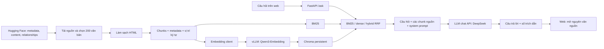

# ⚖ Luật Việt — Vietnamese Legal RAG

**Hỏi đáp pháp luật tiếng Việt từ văn bản nguồn, kèm trích dẫn có thể mở để đối chiếu.**

Dự án triển khai một pipeline Retrieval-Augmented Generation (RAG): tải dữ liệu pháp luật, chuẩn bị corpus, xây BM25 và dense index, kết hợp bằng Reciprocal Rank Fusion (RRF), rồi cung cấp bằng chứng cho LLM tạo câu trả lời. FastAPI phục vụ cả API và giao diện web HTML/CSS/JavaScript.

Bản demo hiện tại sử dụng **200 văn bản, 7.526 chunk và bộ đánh giá retrieval gồm 30 câu hỏi**. Embedding chạy bằng **Qwen3-Embedding-0.6B qua vLLM**; câu trả lời dùng **DeepSeek qua API tương thích OpenAI**. Không fine-tune model trong dự án này.

> Đây là dự án nghiên cứu/demo trên corpus mẫu, không phải dịch vụ của cơ quan nhà nước. Câu trả lời phản ánh nguồn được cung cấp; không tự xác nhận hiệu lực pháp luật tại thời điểm sử dụng và không thay thế tư vấn pháp lý.

## Giao diện và trích dẫn

Ví dụ dưới đây hỏi cơ quan tiếp nhận kê khai hoạt động chăn nuôi. Hệ thống trả lời **Ủy ban nhân dân cấp xã**, đồng thời trích dẫn các đoạn liên quan trong bản Luật Chăn nuôi có trong corpus. Câu hỏi demo này không nằm trong bộ 30 câu đánh giá.

### Câu trả lời trên web


### Nguồn [1] — Điều 54: kê khai hoạt động chăn nuôi

Bấm số trích dẫn mở nguyên văn chunk cùng số hiệu, ngày ban hành, cơ quan và phạm vi văn bản.


### Nguồn [2] — Điều 57: quyền và nghĩa vụ của người chăn nuôi


### Nguồn [3] — Trách nhiệm tổ chức kê khai của UBND cấp xã


Ảnh chụp một lần chạy thực tế; thứ hạng nguồn và cách diễn đạt có thể khác ở lần chạy khác. Số `[1]`, `[2]`, `[3]` chỉ có ý nghĩa trong câu trả lời tương ứng, không phải số điều luật.

## Chức năng hiện có

- Tải toàn bộ ba file nguồn tại revision cố định; đối chiếu checksum và kiểm tra Parquet.
- Chọn 200 văn bản theo loại/phạm vi, seed cố định và danh sách ID được lưu trong repo.
- Làm sạch HTML, chia chunk có vị trí ký tự để truy ngược về text sạch.
- Tìm kiếm BM25, dense hoặc hybrid; giữ nguyên nội dung và metadata của chunk.
- Trả lời từ bằng chứng, trích dẫn `[n]`, trả thông báo thiếu thông tin khi không đủ căn cứ.
- Web tiếng Việt, bố cục responsive, xem nguyên văn nguồn, sao chép và lịch sử trong bộ nhớ tab.
- Đánh giá retrieval với Document Recall@k, Hit@k, MRR@k và độ trễ.

## Kiến trúc



**Hai môi trường chạy độc lập:**

| Thành phần | Chạy ở đâu? | Cần GPU? |
|---|---|---|
| Chuẩn bị dữ liệu, BM25, Chroma, FastAPI và web | Local hoặc máy chạy code dự án | Không; dense gọi API embedding |
| vLLM phục vụ Qwen embedding | Kaggle hoặc máy Linux có GPU tương thích | Có, theo cấu hình serving hiện tại |
| LLM tạo câu trả lời | Dịch vụ chat API bên ngoài | Không cần GPU local |

Khi vLLM và client ở cùng máy, dùng `http://127.0.0.1:8000/v1`. Khi vLLM ở Kaggle còn client ở local, notebook mở ngrok để local truy cập. Ngrok không tạo embedding; nó chuyển tiếp HTTP tới vLLM.

## 1. Cài môi trường dự án

Yêu cầu: Git, Conda và Python 3.11. Các lệnh bên dưới chạy từ thư mục gốc repo.

```bash
git clone https://github.com/nhannhan2201/Vietnamese_Legal_Rag.git
cd Vietnamese_Legal_Rag
conda create -n legal-rag python=3.11 -y
conda activate legal-rag
python -m pip install -e .
```

Nếu đã có môi trường `legal-rag`, chỉ kích hoạt và cài package. `pyproject.toml` khai báo dependency. Chroma đang khóa ở `1.5.9`; chưa có lockfile khóa toàn bộ môi trường.

**Không cài vLLM vào môi trường này.** Phần serving dùng môi trường riêng ở mục 2. Frontend không cần Node, npm hoặc lệnh build.

## 2. Chạy server embedding

### Cách A — Kaggle GPU, theo notebook đã chuẩn bị

Import [vllm-serving-embedding-model.ipynb](vllm-serving-embedding-model.ipynb) lên Kaggle, rồi:

1. Bật **Internet**, chọn **GPU T4**.
2. Trong **Add-ons → Secrets**, thêm và cấp quyền truy cập hai secret:
   - `VLLM_API_KEY`: khóa do bạn tự đặt để bảo vệ API embedding.
   - `NGROK_AUTHTOKEN`: token tài khoản ngrok. Không dùng token này cho client local.
3. Chạy các cell theo thứ tự. Notebook tạo `/kaggle/working/vllm-serve-env`, cài `vllm==0.18.0` và `torch==2.10.0+cu129`, rồi clone/cập nhật repo.
4. Notebook đọc Secrets, đặt đường dẫn CUDA dành cho môi trường này, chạy `scripts/serve_embedding.sh` và chờ server sẵn sàng.
5. Kiểm tra request thiếu key trả **401**; có key trả **200**, vector **1.024 chiều**, giá trị hữu hạn và norm gần 1.
6. Mở ngrok và lấy dòng **`EMBEDDING_BASE_URL`**, ví dụ `https://YOUR-DOMAIN.ngrok-free.dev/v1`.
7. Cell cuối kiểm tra public endpoint một lần rồi chờ server. Giữ phiên hoạt động khi build dense hoặc dùng web.

Lần đầu có thể lâu vì tải thư viện/model và khởi tạo backend. Xem log:

```python
print(LOG.read_text(errors="replace")[-8000:])
```

Notebook dùng GPU 0; không chia model sang GPU thứ hai. Không chạy lại cell khởi động khi cổng 8000 đang được sử dụng. Interrupt cell chờ không chủ động dừng server/tunnel, nhưng cần kiểm tra lại endpoint nếu bị gián đoạn. Kaggle có thể dừng session; notebook và ngrok không tạo dịch vụ thường trực. Nếu session dừng, chạy lại notebook và cập nhật URL nếu thay đổi.

### Cách B — Máy local có GPU tương thích

Công thức serving bên dưới dùng cùng phiên bản với notebook đã thử trên Tesla T4; máy khác cần driver/CUDA tương thích. Tham khảo [hướng dẫn GPU của vLLM 0.18.0](https://docs.vllm.ai/en/v0.18.0/getting_started/installation/gpu/) trước khi thay phiên bản runtime.

Từ thư mục repo, tạo môi trường serving riêng:

```bash
conda create -n legal-rag-serving python=3.13 -y
conda activate legal-rag-serving
python -m pip install wrapt
python -m pip install "vllm==0.18.0" "torch==2.10.0+cu129" --extra-index-url https://download.pytorch.org/whl/cu129
```

Đặt khóa trong terminal này, rồi chạy script:

```bash
read -rsp 'VLLM_API_KEY: ' VLLM_API_KEY
export VLLM_API_KEY
bash scripts/serve_embedding.sh
```

Script **không tự đọc `.env`** và không tự cài thư viện. vLLM nhận khóa qua biến môi trường `VLLM_API_KEY`. Dùng cùng giá trị đó ở `.env` của client. Giữ terminal server chạy; dùng terminal khác cho code RAG.

Script đang khóa các giá trị sau:

| Thông số | Giá trị |
|---|---|
| Model | `Qwen/Qwen3-Embedding-0.6B` |
| Model/tokenizer revision | `97b0c614be4d77ee51c0cef4e5f07c00f9eb65b3` |
| Runner / convert | `pooling` / `embed` |
| Dtype | FP16 |
| GPU / tensor parallel | GPU 0 / 1 |
| Host / port | `127.0.0.1` / `8000` |
| Giới hạn đầu vào server | 2.048 token |
| GPU memory utilization | 0,5 |
| Max sequences / execution | 16 / eager |

`PYTHON_BIN`, `CUDA_VISIBLE_DEVICES`, `HOST`, `PORT`, `MAX_MODEL_LEN`, `GPU_MEMORY_UTILIZATION` có thể truyền qua môi trường. `VLLM_LIBRARY_PATH` chỉ đặt khi máy cần override đường dẫn thư viện; không sao chép đường dẫn Kaggle sang máy khác. Script hỗ trợ override revision, nhưng **phải giữ đồng bộ model/revision với `configs/project.yaml` và index**, không đổi tùy ý sau khi build.

Khi local phục vụ model, endpoint cho client là `http://127.0.0.1:8000/v1`; không cần ngrok. Máy chạy RAG không có GPU vẫn dùng được cách A.

## 3. Cấu hình endpoint và khóa

Tạo `.env` từ mẫu **nếu chưa có**:

```bash
cp -n .env.example .env
```

Mở `.env` và điền:

```dotenv
EMBEDDING_BASE_URL=https://YOUR-NGROK-DOMAIN/v1
VLLM_API_KEY=your-embedding-server-key

LLM_BASE_URL=https://api.vilao.ai/v1
LLM_MODEL=chib/deepseek-v4.1-flash
LLM_API_KEY=your-llm-provider-key
```

- VLLM local: đổi `EMBEDDING_BASE_URL` thành `http://127.0.0.1:8000/v1`.
- Base URL có `/v1`, **không** thêm `/embeddings` hoặc `/chat/completions`; client tự nối đường dẫn.
- LLM mẫu là DeepSeek qua gateway ViLao, không phải endpoint DeepSeek trực tiếp. Model ID và quyền truy cập phụ thuộc tài khoản nhà cung cấp; có thể thay dịch vụ tương thích với client hiện tại.
- Client đọc `.env` tại gốc checkout; giá trị trong file ưu tiên hơn biến terminal. Không cần `source .env`.
- `.env` bị Git bỏ qua; không đưa key vào frontend, ảnh hoặc notebook output. `.env.example` chỉ chứa mẫu.

Thử kết nối embedding trước khi build index:

```bash
conda activate legal-rag
python - <<'PY'
from legal_rag.models.embedding import EmbeddingClient

with EmbeddingClient.from_env() as client:
    vector = client.embed_query("Cơ quan nào tiếp nhận kê khai hoạt động chăn nuôi?")
    print("Số chiều:", len(vector))
PY
```

Kỳ vọng: `Số chiều: 1024`. Đây là một request thật đến embedding server; chưa tìm kiếm Chroma và chưa gọi LLM.

## 4. Chuẩn bị dữ liệu và xây index

Nếu đã có corpus/index hợp lệ tại các đường dẫn bên dưới, chuyển đến mục 5. Không cần build lại mỗi lần mở web.

### 4.1. Tải toàn bộ dữ liệu nguồn, sau đó chọn 200 văn bản

Nguồn: [th1nhng0/vietnamese-legal-documents](https://huggingface.co/datasets/th1nhng0/vietnamese-legal-documents), revision `0a39ad7eae8e6c188cb225c4b1443c3b346461d8`, khai báo trong `configs/project.yaml`.

```bash
python -m legal_rag.data.download
python -m legal_rag.data.sample
python -m legal_rag.data.clean
python -m legal_rag.data.chunk
python -m legal_rag.retrieval.bm25
```

| Bước | Đầu ra chính |
|---|---|
| Download | `data/raw/{metadata,content,relationships}/*.parquet`, manifest nguồn |
| Sample | `configs/sample_200_ids.json`, `data/processed/sample_200/documents.jsonl`, manifest |
| Clean | `data/processed/sample_200/cleaned_documents.jsonl` |
| Chunk | `data/processed/sample_200/chunks.jsonl` |
| BM25 | `data/indexes/sample_200/bm25.pkl`, manifest index |

Download tận dụng cache Hugging Face theo revision, rồi sao chép sang `data/raw/`; cần tính dung lượng cho cả cache và bản local. Relationships được tải để giữ dữ liệu nguồn, chưa dùng làm graph retrieval.

Tập mẫu gồm 40 Luật, 40 Nghị định, 40 Thông tư, 40 Nghị quyết và 40 Quyết định; tổng 160 văn bản toàn quốc và 40 địa phương. Lọc nhãn **“Còn hiệu lực” theo dataset**, không xác minh lại trạng thái pháp lý hiện tại. Danh sách ID đã có được kiểm tra và dùng lại, không chọn ngẫu nhiên lại âm thầm.

Chunking nhận diện Điều và một số ranh giới Chương/Mục/Phần/Phụ lục theo định dạng; phần dài chia tiếp với `RecursiveCharacterTextSplitter`, tối đa **1.000 ký tự**, overlap mục tiêu **200 ký tự** trong cùng phần. Không ghép hai Điều để làm đầy chunk; overlap không được bảo đảm đúng 200 ở mọi cặp. Giữ `doc_id`, `chunk_id`, metadata và `start_char`/`end_char` theo `text[start_char:end_char]` trong văn bản sạch.

### 4.2. Kiểm tra token trước khi gọi embedding hàng loạt

Giới hạn chunk là **ký tự**, giới hạn server là **token**. Nếu tạo lại hoặc thay corpus, kiểm tra bằng đúng tokenizer/revision trước khi build dense. Tokenizer là công cụ kiểm tra bổ sung, không cần tải trọng số/PyTorch local:

```bash
python -m pip install transformers
python - <<'PY'
import json
from pathlib import Path
from transformers import AutoTokenizer
from legal_rag.config import load_config

config = load_config()
tokenizer = AutoTokenizer.from_pretrained(
    config.embedding.model, revision=config.embedding.revision,
)
lengths, exceeded = [], []
for line in Path("data/processed/sample_200/chunks.jsonl").open(encoding="utf-8"):
    chunk = json.loads(line)
    count = len(tokenizer.encode(chunk["text"], add_special_tokens=True))
    lengths.append(count)
    if count > 2048:
        exceeded.append((chunk["chunk_id"], count))
print("Số chunk:", len(lengths))
print("Token nhiều nhất:", max(lengths, default=0))
print("Chunk vượt giới hạn:", exceeded)
if exceeded:
    raise SystemExit("Cần điều chỉnh chunk trước khi xây dense index.")
PY
```

Đây là kiểm tra text document; query còn có instruction do client thêm. Không dùng cấu hình server tự cắt đầu vào để che việc vượt giới hạn.

### 4.3. Xây dense index khi endpoint embedding đã sẵn sàng

```bash
python -m legal_rag.retrieval.dense
```

Code đọc `chunks.jsonl`, gọi embedding theo batch mặc định 16 và lưu Chroma persistent tại:

```text
data/indexes/sample_200/
├── bm25.pkl
├── chroma/
└── manifest.json
```

Model/revision lấy từ YAML, không cần nhập SHA ở mỗi lệnh. Build dense có kiểm tra và tiếp tục phần còn thiếu khi chạy lại với cùng corpus/protocol; không tự trộn index khác phiên bản.

Chroma chạy nhúng trong tiến trình Python, **không cần Docker Compose hoặc server Chroma riêng**. Mỗi record giữ embedding, text và metadata; `chunk_json` là chuỗi JSON chứa toàn bộ record chunk gốc để khôi phục kết quả. BM25 pickle chứa đối tượng BM25 và các record chunk theo cùng thứ tự. Chỉ nạp pickle tin cậy do dự án tạo.

Có thể chạy các file Python này trên Kaggle bằng cùng repo/package rồi tải dữ liệu về. Khi chuyển máy, dừng tiến trình đang ghi/đọc Chroma trước khi sao chép và chuyển **cả** `data/indexes/sample_200/` cùng `data/processed/sample_200/`, giữ phiên bản Chroma. Không chỉ lấy riêng một file `.bin` hoặc `chroma.sqlite3`. Muốn tái xử lý từ raw trên máy mới, chạy lại download để manifest nguồn có đường dẫn local phù hợp.

## 5. Chạy API và web

Đảm bảo có cả hai index, cấu hình `.env` hợp lệ, endpoint embedding đang chạy và chat API truy cập được:

```bash
conda activate legal-rag
python -m uvicorn legal_rag.app.api:app --host 127.0.0.1 --port 8001
```

Đợi `Application startup complete`, giữ terminal chạy và mở **http://127.0.0.1:8001/**. Nếu server cũ đang chạy, dừng bằng `Ctrl+C` rồi khởi động lại để nhận code mới.

| Đường dẫn | Chức năng |
|---|---|
| `GET /` | Gửi HTML giao diện |
| `GET /static/...` | Gửi CSS, JavaScript, ảnh |
| `POST /ask` | Retrieval → prompt có nguồn → LLM → câu trả lời |
| `GET /health` | Xác nhận tài nguyên local đã được nạp; không gọi model |
| `GET /docs` | Tài liệu API tương tác |

Một server phục vụ cả UI và API. Nạp index/client một lần mỗi tiến trình; dùng một worker cho demo. Khởi động web không tự tải corpus hoặc build lại index. Hiện startup nạp cả BM25, dense và hai client ngay cả khi sau đó bạn chọn BM25.

Thử API từ terminal khác:

```bash
curl -sS http://127.0.0.1:8001/ask \
  -H 'Content-Type: application/json' \
  -d '{"question":"Theo Luật Chăn nuôi năm 2018, cá nhân chăn nuôi phải kê khai hoạt động chăn nuôi với cơ quan nào?","method":"hybrid"}'
```

`method` nhận `bm25`, `dense`, `hybrid` (mặc định). Trả về `question`, `method`, `status`, `answer`, `cited_source_ids`, `sources`.

- `answered`: đã tạo câu trả lời có trích dẫn hợp lệ về cú pháp; không đồng nghĩa mọi nhận định được tự kiểm chứng.
- `insufficient_context`: model trả câu từ chối theo quy định khi thiếu bằng chứng.
- `no_sources`: retrieval không có chunk; không gọi LLM.

UI gửi từng câu hỏi độc lập; lịch sử chỉ nằm trong bộ nhớ tab, không được gửi làm ngữ cảnh hội thoại và mất khi reload. Chỉ render Markdown cơ bản, không thực thi HTML trong output. Bấm `[n]` đọc đúng `sources[].text`, không tự tạo link đến cổng văn bản bên ngoài. Không có streaming token hoặc tự retry request.

## 6. Retrieval và đánh giá

**Chỉ trường `text` của chunk tham gia tính điểm**, không thêm metadata vào embedding hoặc BM25. Metadata vẫn được giữ để hiển thị và cung cấp thông tin nguồn cho LLM.

- BM25: Unicode NFC → chữ thường → tách khoảng trắng; `BM25Okapi(k1=1.5, b=0.75)`. Chưa tách từ tiếng Việt hoặc loại stopword.
- Dense: document gửi nguyên text; query có instruction tìm đoạn pháp luật liên quan, thêm đúng một lần trong embedding client. Vector 1.024 chiều, Chroma tìm theo cosine.
- Hybrid: lấy 20 ứng viên mỗi bên, hợp nhất theo `chunk_id` bằng tổng `1 / (60 + rank)`, lấy top 5. Không cộng trực tiếp điểm BM25 với cosine.
- LLM nhận câu hỏi và top chunk nguồn, không đọc ground truth đánh giá. System prompt nằm trong `generation/answer.py`.

Chạy benchmark retrieval, khi endpoint embedding còn hoạt động:

```bash
python -m legal_rag.evaluation.runner --k 5 --bm25-k 20 --dense-k 20 --rrf-k 60
```

Runner nạp 30 câu trong `eval/sample_200/questions.jsonl`, gồm 24 câu một văn bản và 6 câu hai văn bản. Đối chiếu quote/vị trí/checksum trước khi đo; warmup từng phương pháp rồi chạy từng câu độc lập. Không gọi LLM tạo câu trả lời trong benchmark này.

| Chỉ số | Cách tính |
|---|---|
| Document Recall@5 | Số `doc_id` đúng, không trùng, xuất hiện trong top 5 chunk / tổng `doc_id` ground truth |
| Hit@5 | 1 nếu có chunk trong top 5 bao phủ toàn bộ ít nhất một khoảng bằng chứng đúng `doc_id`; nếu không là 0 |
| MRR@5 | Trung bình nghịch đảo hạng của chunk đúng đầu tiên; không có thì 0 |
| Độ trễ retrieval | Thời gian tìm kiếm; dense/hybrid bao gồm embedding và mạng, không gồm load index/chấm điểm/ghi file |

Hit/MRR không đòi hỏi tìm đủ mọi nguồn của câu nhiều văn bản. Document Recall có thể cao dù chunk chưa bao phủ bằng chứng. Điểm tổng hợp là trung bình theo câu, không phải đánh giá chất lượng văn bản trả lời của LLM.

### Baseline đã đo

Kết quả từ lần chạy `20261017_090351_985103_4689675c`, trên corpus 200 văn bản/7.526 chunk:

| Phương pháp | Doc Recall@5 | Hit@5 | MRR@5 | Độ trễ trung bình |
|---|---:|---:|---:|---:|
| BM25 | 0,9833 | 0,8333 | 0,6817 | 114,5 ms |
| Dense | 0,9833 | 0,9000 | 0,7050 | 386,4 ms |
| Hybrid RRF | 0,9833 | 0,8333 | 0,6806 | 501,9 ms |

[Số liệu gốc và định danh corpus](docs/benchmarks/retrieval-baseline.json). Dense đạt Hit/MRR cao nhất trong lần đo này; hybrid vẫn là chế độ demo mặc định. Đây là baseline trên cả 30 câu đã soạn/duyệt, **chưa có tập test độc lập**. Độ trễ phụ thuộc thiết bị, mạng, ngrok và trạng thái server; không phải cam kết hiệu năng production.

Mỗi lần chạy sinh thư mục mới:

```text
results/<run_id>/
├── config.json       # Tham số, định danh dữ liệu/model, trạng thái
├── retrieval.jsonl   # Top chunk, metrics và thời gian từng câu/phương pháp
└── summary.json      # Điểm trung bình của lần chạy hoàn chỉnh
```

Lỗi API làm dừng và đánh dấu lần chạy thất bại; không âm thầm bỏ câu lỗi để tính bảng tổng hợp.

## 7. Cấu trúc repo

```text
Vietnamese_Legal_Rag/
├── README.md
├── PROJECT_PLAN.md
├── PROJECT_STRUCTURE.md
├── pyproject.toml
├── .env.example
├── configs/                 # Dataset/model revision và 200 ID cố định
├── scripts/serve_embedding.sh
├── vllm-serving-embedding-model.ipynb
├── src/legal_rag/
│   ├── config.py            # Đọc YAML, kiểm tra và resolve đường dẫn
│   ├── data/                # Download → sample → clean → chunk
│   ├── models/              # HTTP client embedding và LLM
│   ├── retrieval/           # BM25, dense/Chroma, hybrid RRF
│   ├── generation/answer.py # Prompt, điều phối RAG và kiểm tra trích dẫn
│   ├── evaluation/          # Loader bộ câu hỏi, metrics, runner
│   └── app/                 # FastAPI và static HTML/CSS/JS/ảnh
├── eval/sample_200/          # 30 câu hỏi và manifest kiểm chứng
├── tests/                   # Kiểm tra bằng dữ liệu/client giả
├── docs/                    # Ảnh giao diện và bản số liệu baseline
├── data/                    # Sinh khi chạy, không commit
└── results/                 # Sinh khi đánh giá, không commit
```

Chi tiết trách nhiệm và luồng dữ liệu: [PROJECT_STRUCTURE.md](PROJECT_STRUCTURE.md). Quyết định triển khai: [PROJECT_PLAN.md](PROJECT_PLAN.md).

## 8. Kiểm tra code

```bash
python -m unittest discover -s tests -v
```

Các bài kiểm tra dùng dữ liệu/client giả, không cần GPU hoặc trả phí gọi model. Không thay thế kiểm tra tích hợp với endpoint thật. Đã thử trực tiếp web, trích dẫn, kết quả rỗng, lỗi dịch vụ và hiển thị an toàn nội dung HTML.

## 9. Lỗi thường gặp

| Hiện tượng | Kiểm tra / cách xử lý |
|---|---|
| `ModuleNotFoundError: legal_rag` | Kích hoạt `legal-rag`, chạy `python -m pip install -e .` tại gốc repo |
| Không mở được web | Đợi startup xong, giữ Uvicorn chạy, mở cổng **8001**; không mở trực tiếp `index.html` |
| `Address already in use` | Dừng server cũ trong terminal của nó; không khởi động nhiều tiến trình trên cùng cổng |
| Embedding trả 401 | `VLLM_API_KEY` ở client phải khớp key đã dùng khi khởi động server |
| Ngrok trả HTML/404 hoặc không kết nối | Kiểm tra vLLM local trên Kaggle trước, rồi tunnel hiện còn sống và URL `/v1` trong `.env` |
| Timeout request embedding đầu tiên | Xem log khởi tạo/backend; chờ server hoàn tất rồi thử lại có chủ đích, không tạo thêm server |
| CUDA / nvJitLink / driver lỗi | Dùng môi trường serving riêng theo notebook; không đổi Torch/vLLM tùy ý; kiểm tra driver và đường dẫn thư viện |
| Manifest/checksum không khớp | Dữ liệu/index khác phiên bản: kiểm tra các bước tạo nguồn, không sửa checksum để bỏ qua lỗi |
| Web trả lỗi 502 | Đọc log FastAPI, kiểm tra cả embedding và LLM API; `/health` sẵn sàng không bảo đảm hai dịch vụ ngoài đang hoạt động |

## Giới hạn hiện tại

- Corpus nhỏ, không bao phủ toàn bộ pháp luật Việt Nam. Chưa có pipeline cập nhật/xác minh hiệu lực theo thời gian hoặc lọc metadata khi retrieval.
- Clean HTML chưa OCR nội dung ảnh; một số nhãn danh sách có thể mất, một số khoảng trắng chưa hoàn hảo. Chunking dùng heuristic, chưa phải parser pháp luật đầy đủ.
- Kiểm tra trích dẫn chỉ kiểm tra cú pháp và nguồn tồn tại; chưa tự chấm từng nhận định có thực sự được nguồn hỗ trợ hay không.
- Đã có đánh giá retrieval; chưa có benchmark tự động hoàn chỉnh cho chất lượng câu trả lời, độ đúng trích dẫn và khả năng từ chối.
- Web phục vụ demo local: chưa có xác thực người dùng, rate limiting, persistent chat, tracing hay hạ tầng triển khai production.
- Dataset/model revision và Chroma đã khóa, nhưng dependency còn lại chưa được khóa toàn bộ. Kết quả chạy lại có thể khác thứ hạng/độ trễ/cách diễn đạt.

## Tài liệu tham khảo

- [Dataset pháp luật Việt Nam](https://huggingface.co/datasets/th1nhng0/vietnamese-legal-documents).
- [Model card Qwen3-Embedding-0.6B](https://huggingface.co/Qwen/Qwen3-Embedding-0.6B).
- [vLLM 0.18.0: cài đặt GPU](https://docs.vllm.ai/en/v0.18.0/getting_started/installation/gpu/).
- [Repo tham khảo aio-agentic-rag](https://github.com/ThuanNaN/aio-agentic-rag). Pipeline trong repo này được triển khai theo cấu trúc và các quyết định riêng ở trên; hiện chưa có agent tự lập kế hoạch hoặc graph retrieval.
